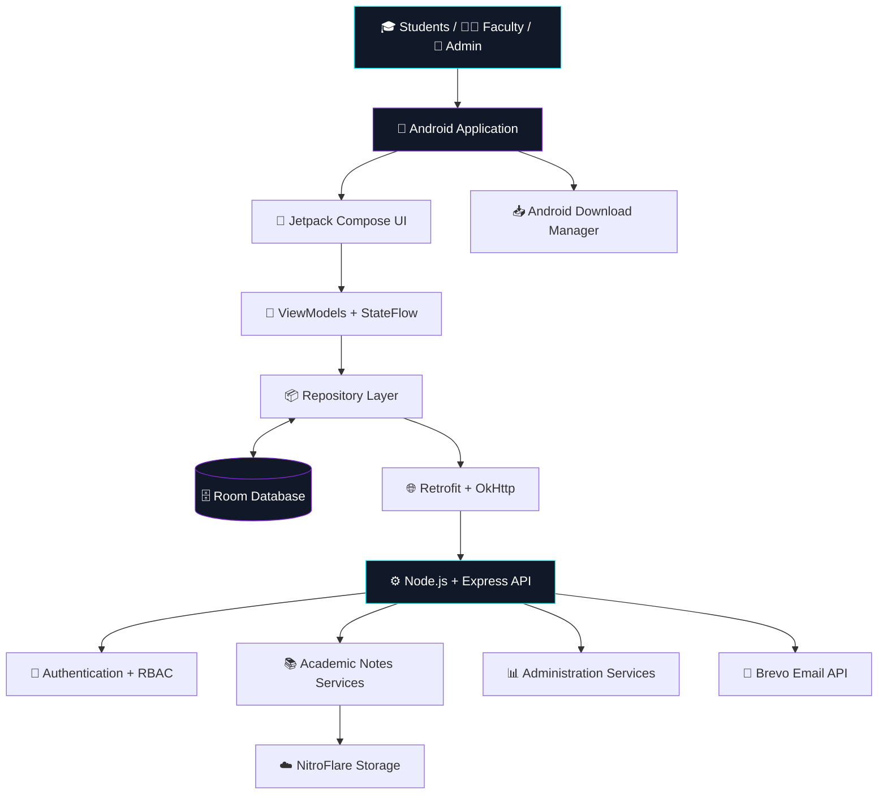
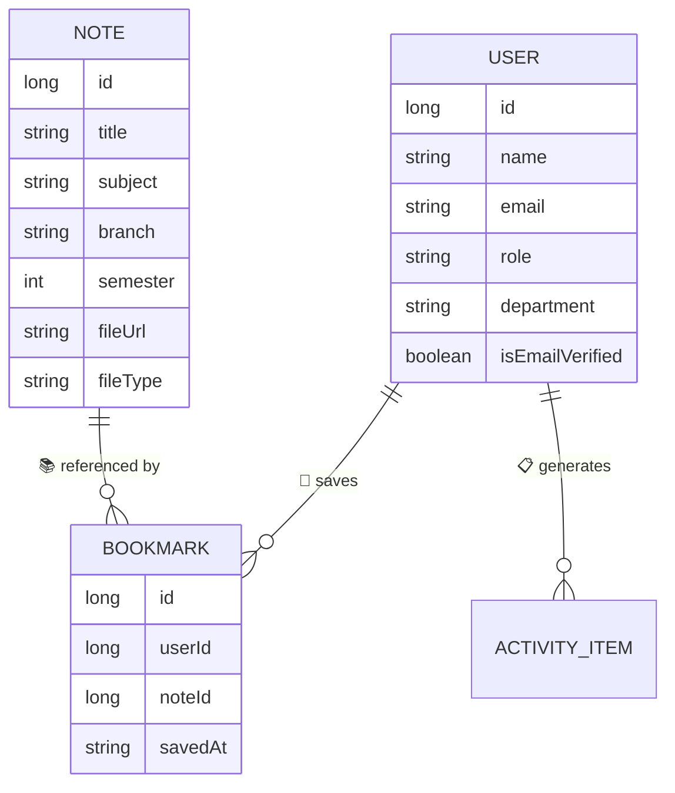

# ⚡🌌 N E O   N O T E S 🌌⚡
### 🚀💎 THE NEXT GENERATION OF CAMPUS KNOWLEDGE 💎🚀

<p align="center">
  📚✨ <b>YOUR CAMPUS. YOUR KNOWLEDGE. YOUR REPOSITORY.</b> ✨📚
  <br/><br/>
  🎓 A futuristic academic ecosystem for students, faculty, and universities.
  <br/>
  🔥 Discover. 📖 Learn. ☁️ Share. 🚀 Excel.
</p>

<p align="center">
  
  
  
  
</p>

<p align="center">
  
  
  
  
  
</p>

<p align="center">
  🌟 <a href="#-overview">Overview</a> •
  ✨ <a href="#-features">Features</a> •
  🛠️ <a href="#-tech-stack">Tech Stack</a> •
  🏗️ <a href="#-architecture">Architecture</a> •
  🔐 <a href="#-security">Security</a> •
  🚀 <a href="#-installation">Installation</a>
</p>

---

## 🌌✨ 01 — 🚀 PROJECT OVERVIEW

**NEO NOTES** 📚 is a modern, full-stack Android application engineered to transform how academic knowledge is organized, discovered, and shared across college campuses. 🎓🏫

From lecture notes 📝 and question banks 📑 to presentations 📊, syllabus documents 📘, and laboratory resources 🧪, NEO NOTES brings essential academic materials together in one centralized digital repository. ☁️💎

Powered by **Kotlin 💜, Jetpack Compose 🎨, Material Design 3 ✨, and Node.js ⚙️**, the platform combines academic productivity with a futuristic cyberpunk interface. 🌃⚡

> 💠 **ACCESS KNOWLEDGE. 🔓 SHARE INTELLIGENCE. 🧠 ELEVATE LEARNING. 🚀**

### 🎯💫 Our Mission

- 📚 Centralize academic resources in one accessible platform.
- 👨‍🎓 Connect students and faculty through knowledge sharing.
- 🔎 Simplify academic search and resource discovery.
- 🔐 Support email verification and role-based access.
- ☁️ Enable cloud-based document delivery.
- 📥 Make important resources easy to download and bookmark.
- 📊 Provide administrators with useful repository insights.
- 🎨 Deliver a premium, futuristic Android experience.

---

## ✨🔥 02 — FEATURE MATRIX

<table>
<tr>
<td width="50%" valign="top">

### 🔐🛡️ Identity & Security

- 📩 Email OTP verification
- 👨‍🎓 Student accounts
- 👨‍🏫 Faculty accounts
- 🛡️ Administrator roles
- ⏳ Verification expiry
- 🚦 Attempt limits
- 🔑 Session persistence

</td>
<td width="50%" valign="top">

### 📚🎓 Academic Repository

- 📝 Lecture notes
- 📑 Question banks
- 📘 Syllabus documents
- 📊 Presentations
- 🔬 Research papers
- 🧪 Laboratory materials
- 🏷️ Semester-wise organization

</td>
</tr>
<tr>
<td width="50%" valign="top">

### 🔎⚡ Smart Discovery

- 🔍 Search academic resources
- 🏷️ Filter by subject
- 🎓 Browse by semester
- 🏫 Explore departments
- 👨‍🏫 View author information
- 📄 Inspect document metadata

</td>
<td width="50%" valign="top">

### ☁️📥 Cloud & Offline Access

- 🌐 NitroFlare integration
- 📥 Document downloads
- 🗄️ Room local persistence
- 🔖 Bookmarked resources
- 📱 Local file access
- 🔄 Convenient resource retrieval

</td>
</tr>
<tr>
<td width="50%" valign="top">

### 👨‍🏫📤 Faculty Workspace

- 📂 Academic resource uploads
- 🏷️ Subject tagging
- 📅 Semester assignment
- ✍️ Author metadata
- 📈 Engagement tracking

</td>
<td width="50%" valign="top">

### 👑📊 Administration Center

- 👥 User management
- 📚 Repository statistics
- 📤 Upload activity
- 📥 Download metrics
- ☁️ Storage monitoring
- 📋 Activity records

</td>
</tr>
</table>

---

## 🛠️💻 03 — TECHNOLOGY STACK

<p align="center">
  
</p>

| 🔧 Category | ⚡ Technology |
|---|---|
| 📱 Mobile Platform | Android |
| 💜 Programming Language | Kotlin |
| 🎨 UI Framework | Jetpack Compose |
| ✨ Design System | Material Design 3 |
| 🔄 State Management | StateFlow, SharedFlow |
| ⚙️ Asynchronous Processing | Kotlin Coroutines |
| 🗄️ Local Database | Room Database |
| 🔑 Session Storage | SharedPreferences |
| 🌐 Networking | Retrofit, OkHttp 4 |
| 📦 Serialization | kotlinx.serialization, org.json |
| 🖼️ Image Loading | Coil Compose |
| 🖥️ Backend | Node.js, Express.js |
| 📩 Email Service | Brevo Transactional Email API |
| ☁️ Cloud Storage | NitroFlare API |
| 📥 File Management | Android Download Manager |
| 🏗️ Build System | Gradle |

---

## 🏗️🌐 04 — SYSTEM ARCHITECTURE



### 🧩⚙️ Architecture Highlights

- 🎨 **Presentation Layer:** Compose screens and reusable UI components.
- 🔄 **State Layer:** ViewModels, StateFlow, and SharedFlow.
- 📦 **Data Layer:** Repository pattern, Retrofit, and Room.
- 🖥️ **Backend Layer:** Express REST APIs and application services.
- ☁️ **Cloud Layer:** Email delivery and document storage integrations.
- 📱 **Local Layer:** Persistent saved data and download management.

*📌 This is the intended architecture; verify component connections against the actual implementation.*

---

## 🔐📩 05 — EMAIL VERIFICATION PROTOCOL

NEO NOTES includes an email OTP workflow for applicable authentication operations. 🛡️

```text
┌───────────────────────────────────┐
│ 📧 ENTER EMAIL ADDRESS            │
└────────────────┬──────────────────┘
                 ▼
┌───────────────────────────────────┐
│ 🔢 REQUEST SIX-DIGIT OTP          │
└────────────────┬──────────────────┘
                 ▼
┌───────────────────────────────────┐
│ 🌐 BACKEND + BREVO EMAIL SERVICE  │
└────────────────┬──────────────────┘
                 ▼
┌───────────────────────────────────┐
│ 📩 RECEIVE VERIFICATION CODE      │
└────────────────┬──────────────────┘
                 ▼
┌───────────────────────────────────┐
│ 🔎 VALIDATE CODE + EXPIRY         │
└────────────────┬──────────────────┘
                 ▼
┌───────────────────────────────────┐
│ ✅ VERIFIED ACCESS                │
└───────────────────────────────────┘
```

### 🛡️ Security Specifications

| 🔐 Mechanism | ⚙️ Configuration |
|---|---|
| 🔢 OTP Generation | `java.security.SecureRandom` |
| 🔠 OTP Length | 6 digits |
| ⏳ Expiration | 10 minutes |
| 🔁 Resend Cooldown | 60 seconds |
| 🚦 Attempt Limit | 5 attempts before lockout |
| 👥 Authorization | Role-based access control |
| 🔑 Sessions | Persistent session state |

> ⚠️ **Security First:** OTP validation, rate limiting, and authorization must be enforced by a trusted backend. Never expose production API keys, OTP secrets, or private credentials in your Android APK or public GitHub repository.

---

## 📚🌍 06 — ACADEMIC KNOWLEDGE REPOSITORY

### 🏫📂 Resource Hierarchy

```text
🌌 NEO NOTES
│
├── 🏫 DEPARTMENTS
│   ├── 💻 Information Technology
│   ├── 🖥️ Computer Science
│   ├── 📡 Electronics & Communication
│   ├── ⚙️ Mechanical Engineering
│   └── 🏗️ Civil Engineering
│
├── 🎓 SEMESTERS
│   ├── 1️⃣ Semester 01
│   ├── 2️⃣ Semester 02
│   ├── 3️⃣ Semester 03
│   ├── 4️⃣ Semester 04
│   ├── 5️⃣ Semester 05
│   ├── 6️⃣ Semester 06
│   ├── 7️⃣ Semester 07
│   └── 8️⃣ Semester 08
│
└── 📖 RESOURCES
    ├── 📝 Lecture Notes
    ├── 📑 Question Banks
    ├── 📘 Syllabus
    ├── 📊 Presentations
    ├── 🔬 Research Papers
    └── 🧪 Laboratory Materials
```

### 📄💎 Supported File Formats

<p align="center">
  
  
  
  
</p>

Each resource can contain:

- 🏷️ Title and subject
- 🏫 Department and semester
- 👨‍🏫 Faculty or author
- 📦 File type and size
- 🔗 Resource URL
- 📅 Upload date
- 📥 Download count
- ⭐ Rating information

---

## 🗄️🔗 07 — DATABASE DESIGN

The local Room database supports persistent application data. 💾

| 🧩 Entity | 📌 Responsibility |
|---|---|
| 👤 `User` | User profile, role, department, verification |
| 📚 `Note` | Academic document metadata |
| 🔐 `EmailVerification` | OTP state and expiration metadata |
| 🔖 `Bookmark` | Saved academic resources |
| 🔔 `NotificationItem` | Notification state |
| 📋 `ActivityItem` | Activity and audit-related records |

### 🔗 Data Relationships



📌 *These are illustrative logical relationships. Match the field types, keys, and constraints to the actual implementation.*

---

## 🎨🌃 08 — CYBERPUNK DESIGN SYSTEM

NEO NOTES embraces a futuristic interface with dark surfaces, neon highlights, and clean academic layouts. ⚡💎

| 🎨 Design Token | 💠 Hex Code | ✨ Purpose |
|---|---|---|
| 🌌 `SPACE_NAVY` | `#080A18` | Main background |
| 🪟 `GLASS_SURFACE` | `#0E1228` | Elevated surfaces |
| 🔷 `BORDER_BLUE` | `#1E2958` | Card boundaries |
| 💎 `CYBER_CYAN` | `#00F0FF` | Primary highlights |
| 🔮 `NEON_PURPLE` | `#7928CA` | Secondary accents |
| 🟢 `ELECTRIC_GREEN` | `#00E676` | Success states |
| 🔴 `LASER_RED` | `#FF5252` | Errors and warnings |

### ✨ Interface Highlights

- 🌌 Deep-space dark backgrounds
- 🪟 Glassmorphic card surfaces
- 💠 Cyan neon accents
- 🔮 Purple highlights
- 🔢 Animated OTP input fields
- 🏷️ Rounded status badges
- 📊 Telemetry-inspired dashboard elements
- 📱 Edge-to-edge Android layouts
- ⚡ Interactive transitions and visual feedback

---

## 🚀🛠️ 09 — INSTALLATION & EXECUTION

### 📋 Prerequisites

- 🤖 Android Studio
- 📦 Compatible Android SDK
- ☕ JDK compatible with the configured Gradle version
- 🐙 Git
- 🟢 Node.js and npm, if the backend is included

### 1️⃣ 📥 Clone the Repository

```bash
git clone https://github.com/Rmy4143/Neo-Notes-Sharing-Apk.git
cd Neo-Notes-Sharing-Apk
```

### 2️⃣ 🎨 Open the Android Project

1. 🚀 Launch Android Studio.
2. 📂 Open the cloned repository.
3. 🔄 Wait for Gradle synchronization.
4. 📦 Install any missing SDK components.

### 3️⃣ ⚙️ Configure the Backend

If the repository contains a `server` directory:

```bash
cd server
npm install
```

Create a local `.env` file using the variable names required by your backend:

```env
PORT=5000
NODE_ENV=development
BREVO_API_KEY=your_brevo_api_key
NITROFLARE_API_KEY=your_nitroflare_api_key
```

🔐 Never commit real API keys or `.env` files.

Start the server using the configured script in `package.json`, for example:

```bash
npm start
```

### 4️⃣ 🌐 Configure the API URL

| 📱 Environment | 🌍 Example |
|---|---|
| 🤖 Android Emulator | `http://10.0.2.2:5000` |
| 📲 Physical Device | `http://YOUR_COMPUTER_LAN_IP:5000` |
| ☁️ Production | Your deployed HTTPS API URL |

⚠️ **Important:** `localhost` inside an Android emulator refers to the emulator itself. Use `10.0.2.2` to reach a backend running on your development computer from the standard Android Emulator.

🔒 Use HTTPS in production and configure development networking appropriately.

### 5️⃣ 🏗️ Build the APK

On Windows PowerShell, from the project root:

```powershell
.\gradlew.bat assembleDebug
```

📦 The APK is typically generated at:

```text
app/build/outputs/apk/debug/app-debug.apk
```

Alternatively, use **Android Studio → Build → Build APK(s)**.

---

## 🧪✅ 10 — PRE-RELEASE CHECKLIST

- [ ] 🌐 API base URL is correct.
- [ ] ⚙️ Backend starts successfully.
- [ ] 🗄️ Database connection is configured.
- [ ] 📩 OTP emails are delivered successfully.
- [ ] 🔐 Verification and rate limiting work correctly.
- [ ] 👥 Student, teacher, and admin permissions are enforced.
- [ ] 📤 Resource uploads work.
- [ ] 📥 Document downloads work.
- [ ] 🔖 Bookmarks persist after restarting the app.
- [ ] ☁️ Cloud storage integration is configured.
- [ ] 🔑 Production secrets are excluded from Git.
- [ ] 🧪 Critical flows have been tested.

---

## 🔮🚧 11 — FUTURE ROADMAP

- [ ] 🤖 AI-powered semantic academic search
- [ ] 🧠 Personalized resource recommendations
- [ ] 🔔 Push notifications for new uploads
- [ ] 📖 Enhanced in-app PDF reader
- [ ] 🌍 Multilingual interface support
- [ ] 🔄 Improved offline-first synchronization
- [ ] 📈 Advanced analytics and reporting
- [ ] 🛡️ Stronger audit and security monitoring
- [ ] 🏫 Institution-specific repository settings
- [ ] 🧪 Automated API and authentication tests

---

## 🤝💜 12 — CONTRIBUTION PROTOCOL

Want to make NEO NOTES even better? 🌟 Contributions and suggestions are welcome!

```bash
git checkout -b feature/your-feature-name
git add .
git commit -m "Add: your feature description"
git push origin feature/your-feature-name
```

🚀 Open a Pull Request with a clear explanation of your changes and test results.

💡 Keep contributions focused, document configuration changes, and never include secrets in commits.

---

## 👨‍💻🌟 13 — DEVELOPER

### ⚡ Bhagyesh Patil

🎓 **B.Tech — Information Technology**

💻 Android Development • 🌐 Full-Stack Development • 🛠️ Software Engineering

<p align="center">
  <a href="https://github.com/Rmy4143">
    
  </a>
</p>

---

<p align="center">
  🌌━━━━━━━━━━━━━━━━━━━━━━━━━━━━━━━━━━━━🌌
  <br/><br/>
  # ⚡ NEO NOTES ⚡
  <br/>
  <b>📚 YOUR CAMPUS. 💎 YOUR KNOWLEDGE. 🚀 YOUR REPOSITORY.</b>
  <br/><br/>
  🔐 Secure Learning • ☁️ Connected Knowledge • 🎓 Smarter Campuses
  <br/><br/>
  <sub>💜 Designed for a more connected academic future. 🌠</sub>
  <br/><br/>
  🌌━━━━━━━━━━━━━━━━━━━━━━━━━━━━━━━━━━━━🌌
</p>
